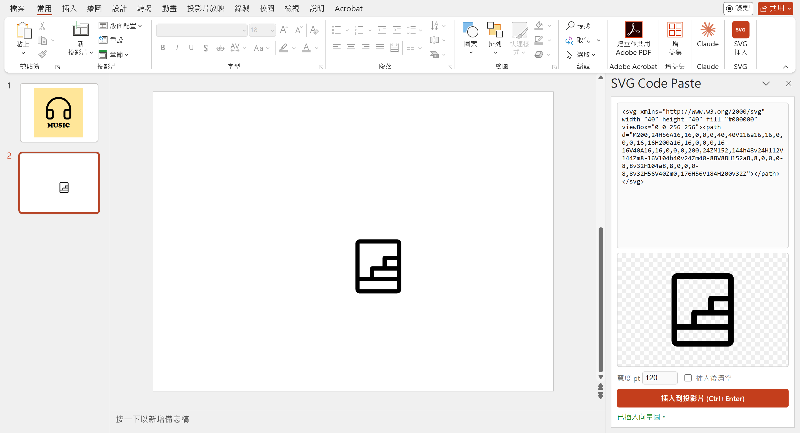

# PPT SVG Code Paste

PowerPoint 工作窗格增益集：貼上 SVG (XML) 程式碼，直接以向量圖插入目前的投影片，不用先存成 .svg 檔再匯入。

適合把 AI 生成或從圖示庫複製來的 SVG 程式碼，快速放進簡報。



示例圖中的圖示 (耳機、階梯) 取自 [Phosphor Icons](https://phosphoricons.com/)，採 [MIT 授權](https://github.com/phosphor-icons/core/blob/main/LICENSE)。

## 功能

- 右側窗格貼上程式碼，即時預覽 (棋盤格背景可看出透明區)
- 自動去掉從聊天複製時夾帶的 ``` 標記，缺少 `xmlns` 時自動補上，XML 格式錯誤會提示
- 可設定插入寬度 (pt，0 = 原尺寸)，Ctrl+Enter 插入，可勾選插入後清空
- 插入結果是 SVG 圖形 (向量)，可在 PPT 裡右鍵「轉換為圖形」後改色、拆解
- 技術上使用 Office.js `setSelectedDataAsync` 搭配 `Office.CoercionType.XmlSvg`

## 系統需求

- Windows 版 PowerPoint (Microsoft 365 / 2019 以後，需支援 SVG)
- [Node.js](https://nodejs.org/) (只在安裝時用到，用來執行微軟官方的側載工具)
- 窗格頁面由 GitHub Pages 提供，使用時需要連網

## 安裝 (側載)

這個增益集沒有上架 Office 市集，要用「側載」(Sideload) 的方式裝到自己的電腦。

1. **下載 manifest**：把本倉庫的 [`manifest.xml`](manifest.xml) 存到本機一個固定、之後不會搬動的資料夾，例如 `D:\OfficeAddins\ppt-svg-code-paste\manifest.xml`。

2. **執行微軟官方側載工具**：開 PowerShell 或命令提示字元，執行 (路徑換成你存放的位置)：

   ```bash
   npx office-addin-dev-settings sideload "D:\OfficeAddins\ppt-svg-code-paste\manifest.xml" desktop --app powerpoint
   ```

   第一次執行時 npx 會詢問是否下載工具，輸入 `y` 同意。

3. **確認載入**：PowerPoint 會自動開啟一份名為 `PowerPoint add-in 4fa1aa32-....pptx` 的暫存簡報，右側出現「SVG Code Paste」窗格就代表安裝成功。這份暫存簡報不用存檔，可以直接關掉。

4. **之後使用**：在「常用」索引標籤最右邊按「SVG 插入」開啟窗格。若沒看到按鈕，到「常用 > 增益集」(或「插入 > 我的增益集」) 的「開發人員增益集」區找 SVG Code Paste。

### 移除

```bash
npx office-addin-dev-settings unregister "D:\OfficeAddins\ppt-svg-code-paste\manifest.xml"
```

或手動刪除登錄檔 `HKEY_CURRENT_USER\Software\Microsoft\Office\16.0\WEF\Developer` 底下名稱為 `4fa1aa32-29a9-4519-82dd-e7d9b2a5e3cc` 的值，再重開 PowerPoint。

## 疑難排解

| 狀況 | 原因與解法 |
| --- | --- |
| 自己寫了登錄值，重開 PowerPoint 還是看不到增益集 | 只寫登錄值不夠。官方工具在寫入登錄值之後，還會開一份內嵌增益集 ID 的範本簡報，由這份簡報觸發載入。請改用上方的 `npx` 指令。 |
| 登錄值的格式 | 值的**名稱**是 manifest 裡的 `<Id>` (GUID)，**資料**才是 manifest 的完整路徑。名稱寫成路徑 Office 不會認得。 |
| 窗格空白或顯示載入失敗 | 確認可以連到 <https://ag-0814.github.io/ppt-svg-code-paste/taskpane.html>。 |
| 插入按鈕是灰色、顯示「沒有連上 PowerPoint」 | 頁面是在一般瀏覽器裡開的。只有在 PowerPoint 的窗格裡才能插入。 |

## 檔案說明

| 檔案 | 用途 |
| --- | --- |
| `manifest.xml` | 增益集設定：窗格網址、功能區按鈕、圖示 |
| `taskpane.html` | 窗格本體 (單一 HTML，無建置步驟) |
| `assets/` | 功能區與增益集清單用的圖示 |
| `docs/` | README 用的示意截圖 |
